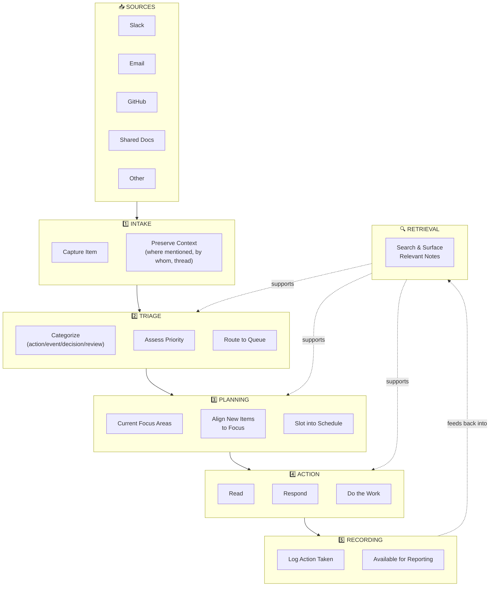
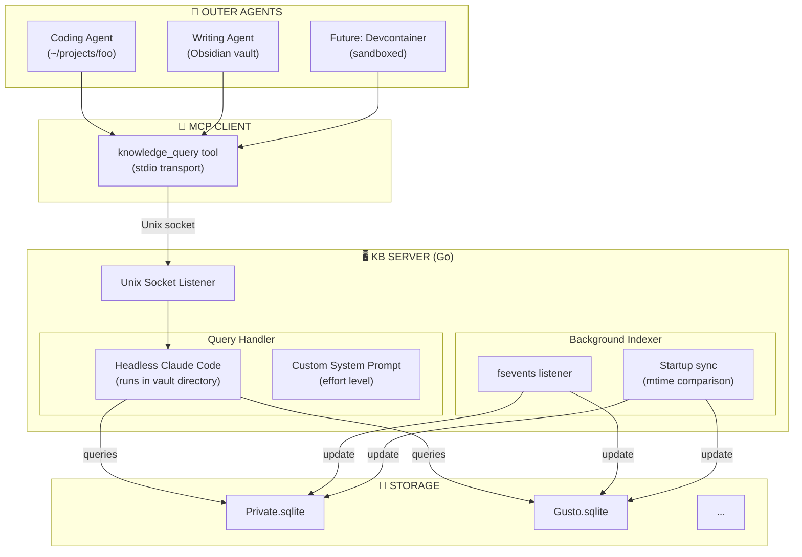
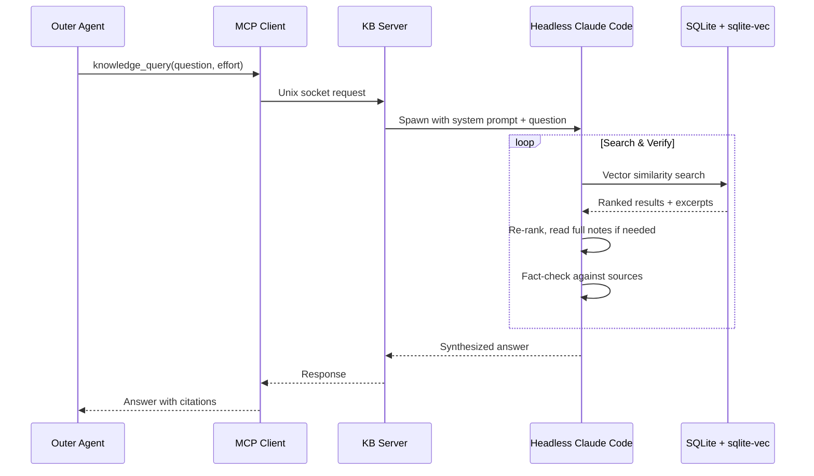
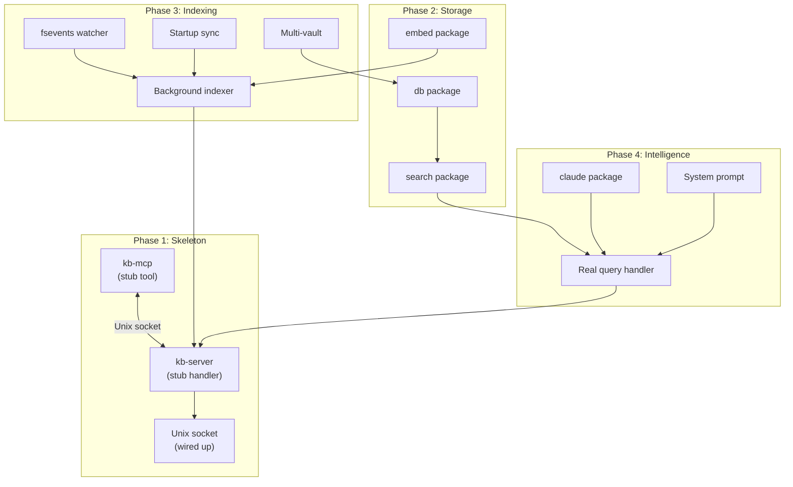

# Weekend Project: AI-Powered Information Tools

> [!CAUTION]
> This is horribly out-of-date with the current vision and principles. The concept has since evolved. Treat this as a historic record, not canonical truth.

> Scoped to Jan 31 - Feb 2, 2026. Build for myself first.

---

## The Problem

Information is coming in faster than I can process it thoughtfully. I end up reading what feels emotionally urgent rather than what's actually important. My 1500+ note Obsidian vault is a goldmine, but retrieval is inconsistent - agents struggle to find the right context.

**The goal:** Reclaim my attention by building tools that help me intake, triage, and retrieve information more effectively.

---

## High-Level Workflow



---

## Component Breakdown

### 1️⃣ Intake

**Current State:** Manual. Copy-paste from various sources, lose context.

**Ideal State:** Quick capture from any source that preserves:
- Original content (or link)
- Where it was mentioned (channel, thread, email)
- Who mentioned it
- Timestamp

**What it would take:**
- Slack integration (bookmarking? webhook? manual clip?)
- Browser extension or bookmarklet for docs/links
- iPad-friendly capture method
- Standard format for captured items in Obsidian

**Complexity:** Medium-High (multiple integrations)

---

### 2️⃣ Triage

**Current State:** Manual and reactive. I read based on emotional pull, not actual priority.

**Ideal State:** Agent reviews new items and:
- Categorizes (action / event / decision / review / FYI)
- Assesses urgency and importance
- Suggests priority
- Asks me when ambiguous

**What it would take:**
- Triage agent prompt/tool
- Integration with task list or queue
- Rules engine or heuristics for priority
- Feedback loop to learn my preferences

**Complexity:** Medium (if intake exists)

**Dependency:** Needs intake to be working first, OR a backlog to process

---

### 3️⃣ Planning

**Current State:** I have high-level goals but they're not systematically connected to incoming items.

**Ideal State:** Agent helps assess new items against my current focus areas and flags misalignment.

**What it would take:**
- Documented focus areas (already have in Timeline doc!)
- Agent that cross-references new items against focus
- Visual dashboard of "focus alignment"

**Complexity:** Low-Medium (builds on triage)

---

### 4️⃣ Action

**Current State:** When I have time, I read what's in front of me. iPad is underutilized.

**Ideal State:** Dedicated reading time with the most important items surfaced. iPad as reading device with Obsidian sync.

**What it would take:**
- Reading queue sorted by priority
- iPad workflow (already have Obsidian sync!)
- Annotation/note-taking flow on iPad

**Complexity:** Low (mostly habit + using existing tools)

---

### 5️⃣ Recording

**Current State:** Manual logging, sometimes forgotten.

**Ideal State:** Lightweight capture of actions taken for manager updates and self-reflection.

**What it would take:**
- Quick-log template or tool
- Integration with daily notes

**Complexity:** Low

---

### 🔍 Retrieval (Cross-Cutting)

**Current State:** Agents struggle to find relevant info. Wrong notes surface, or nothing surfaces.

**Ideal State:** Agents can reliably find relevant context from my 1500+ notes.

**What it would take:**
- Better search tools for agents (semantic? structured?)
- Improved note metadata/tagging
- Index or graph of relationships
- Custom MCP tools for vault navigation

**Complexity:** Medium-High (but high leverage)

---

## Weekend Focus: 🔍 Retrieval

### Why Retrieval?

**Next week's work pattern:**
1. **Meetings** → transcripts → notes (workflow already solid, ~20 seconds)
2. **Research** → intake from blogs, YouTube, GitHub, etc. → digest → synthesize (YouTube utility exists, blogs manageable)
3. **Epic formulation** → need to pull relevant context from vault to shape direction
4. **Backlog creation** → tickets need relevant information attached

**The insight:** I'll be *generating* a lot of new information (meetings, research), then *connecting* it to what I already know to produce artifacts (epics, tickets).

If agents can't find the right stuff in my 1500-note vault, **I become the bottleneck** - manually hunting for context instead of synthesizing and creating.

**Better retrieval multiplies everything else.**

### What Monday Looks Like With Good Retrieval

> "Hey Claude, I need to draft an epic for sandboxed execution environments. Pull relevant context from my notes about the architecture discussions with Taylor, the infrastructure discussions, and any prior art we've discussed."

And it actually works. Instead of me digging through notes while the agent hallucinates.

---

## Deprioritized Options (For Now)

| Option | Why Not This Weekend |
|--------|---------------------|
| **Intake** | YouTube transcript tool exists. Blog posts manageable. Not the bottleneck right now. |
| **Triage** | Next week is active research with intent, not drowning in notifications. More relevant after kickoff when async flood starts. |
| **Planning** | Focus areas already documented in Timeline doc. I know what I'm working on. |
| **iPad Reading** | Distraction reduction, not the core problem. Might be a time-blocking issue more than tooling. |

---

## Retrieval: What to Build

### The Core Problems

**1. People discovery by role/expertise**
- "I'm going to do X. Who should I reach out to proactively?"
- "I'm having a problem with Y. Who should I ask?"
- "Who should I tag about Z?"
- I don't remember everyone's names - I need to search by *what they do*, not *who they are*

**2. Context loading without hand-holding**
- Fresh conversations require me to provide file paths
- Agents fumble around wasting tokens
- I want to say "let's work on the sandboxing epic" and have it find the right starting context

### Why Semantic Search

- **Content is good, metadata is inconsistent** - Agents write 95% of content and make mistakes
- **Natural language queries** - Ask questions the way I think, not by filename or tag
- **Robust to imperfection** - Works even when tags are missing or inconsistent
- **Scales with the vault** - 1500 notes and growing

Fiddling with vault organization is a losing battle. Semantic search is the right abstraction.

### What to Build: Knowledge Service

**"My second brain as a service"** - any agent, anywhere, can tap into my knowledge.

---

## Architecture

### System Overview



### Query Flow



---

## Tech Stack

| Component | Technology | Notes |
|-----------|------------|-------|
| Server | Go | Single binary, fast startup |
| Vector Store | SQLite + sqlite-vec | Embedded, no external deps |
| Embeddings | OpenAI API | `text-embedding-3-small` |
| Search Agent | Headless Claude Code | Already knows how to read files, reason |
| IPC | Unix socket | Clean, works in devcontainers if mounted |
| MCP Transport | stdio | Standard MCP client pattern |

---

## Components

### 1. MCP Client (`kb-mcp`)

Lightweight stdio MCP server that exposes a single tool.

**Tool:** `knowledge_query`

```typescript
{
  name: "knowledge_query",
  description: "Query your personal knowledge base (Obsidian vaults)",
  parameters: {
    question: string,      // Free-form question
    effort?: "low" | "medium" | "high",  // How thorough (default: medium)
    vaults?: string[]      // Which vaults to search (default: all)
  }
}
```

**Connects to:** `${XDG_RUNTIME_DIR:-/tmp}/kb.sock`

**Usage:** Add to any project's MCP config to give agents access to your knowledge.

### 2. KB Server (`kb-server`)

Long-running daemon that handles queries and manages indexing.

**Listens on:** Unix socket (configurable, default `${XDG_RUNTIME_DIR:-/tmp}/kb.sock`)

**On query:**
1. Receive question + effort level
2. Spawn headless Claude Code in vault directory
3. Pass custom system prompt with instructions + effort level
4. Return synthesized answer

**Background tasks:**
- **fsevents listener** - Re-embed notes as they change during runtime
- **Startup sync** - Detect and process changes that happened while server was down

---

## Storage

### Database Location

```
${XDG_DATA_HOME:-~/.local/share}/kb/<vault-id>.sqlite
```

### Vault ID Convention

To avoid collisions, vault paths are converted to safe filenames:

**Option A: Basename + Hash** (recommended)
```
/Users/ivy/Obsidian/Private  →  Private-a1b2c3d4.sqlite
/Users/ivy/Obsidian/Public   →  Public-e5f6g7h8.sqlite
```
Where hash = first 8 chars of SHA256 of full absolute path.

Human-readable, collision-resistant, reversible via lookup table.

**Option B: URL Encoding**
```
/Users/ivy/Obsidian/Private  →  %2FUsers%2Fivy%2FObsidian%2FPrivate.sqlite
```
Ugly but guaranteed unique.

### Schema

```sql
-- Vault metadata
CREATE TABLE vault (
    id INTEGER PRIMARY KEY,
    path TEXT UNIQUE NOT NULL,
    last_sync TIMESTAMP
);

-- Notes with embeddings
CREATE TABLE note (
    id INTEGER PRIMARY KEY,
    vault_id INTEGER REFERENCES vault(id),
    path TEXT NOT NULL,           -- Relative to vault root
    mtime TIMESTAMP NOT NULL,     -- For change detection
    content_hash TEXT,            -- Optional, for verification
    title TEXT,
    embedding BLOB,               -- sqlite-vec vector
    UNIQUE(vault_id, path)
);

-- Virtual table for vector search
CREATE VIRTUAL TABLE note_vec USING vec0(
    embedding float[1536]         -- OpenAI embedding dimension
);
```

---

## Headless Claude Code Integration

### Invocation

```bash
claude --print --dangerously-skip-permissions \
  --system-prompt "$(cat /path/to/kb-agent-prompt.md)" \
  --cwd /Users/ivy/Obsidian/Private \
  -p "User question here"
```

### System Prompt (sketch)

```markdown
You are a knowledge retrieval agent. Your job is to answer questions
using the user's Obsidian vault.

## Tools Available

You have access to semantic search over the vault which returns
similar notes. Use it to find relevant information.

## Process

1. Run initial search with relevant terms
2. Review results and identify promising notes
3. Read full notes if excerpts are insufficient
4. Re-rank based on actual relevance to the question
5. Fact-check your answer against source material
6. Synthesize a clear response with citations

## Effort Level: {effort}

- **low**: Quick answer, 1-2 searches max, surface-level
- **medium**: Thorough answer, follow leads, verify claims
- **high**: Comprehensive research, multiple angles, fully cited

## Output Format

Provide a direct answer to the question. Include:
- The answer itself
- Key sources (note titles/paths)
- Confidence level if uncertain

Do NOT include raw search results or unnecessary preamble.
```

---

## Change Detection

### Runtime (fsevents)

- Server watches indexed vault directories
- On file change: re-embed the note
- On file delete: remove from index
- On file create: embed and add

### Startup Sync

On server start:
1. Load `(path, mtime)` for all indexed notes
2. Scan vault directories
3. Compare mtimes:
   - **Changed:** mtime differs → re-embed
   - **New:** not in index → embed and add
   - **Deleted:** not on disk → remove from index
4. Update `last_sync` timestamp

This is fast (just stat calls) and handles offline changes correctly.

---

## Weekend Scope

### Must Have
- [ ] `kb-server`: Unix socket listener, handles queries, manages indexing
- [ ] `kb-mcp`: MCP client that connects to server
- [ ] End-to-end working: ask question → get answer

### Nice to Have
- [ ] fsevents watcher for live updates
- [ ] Startup sync for offline changes
- [ ] Multiple vault support
- [ ] Effort level affecting behavior

### Future
- [ ] Hybrid search (semantic + keyword + recency)
- [ ] Caching for common queries
- [ ] Streaming responses
- [ ] Devcontainer socket mounting

---

## File Structure

```
kb/
├── cmd/
│   ├── kb-server/     # Main daemon
│   └── kb-mcp/        # MCP client
├── internal/
│   ├── db/            # SQLite + sqlite-vec operations
│   ├── embed/         # OpenAI embedding calls
│   ├── search/        # Vector search logic
│   ├── index/         # Indexing logic
│   └── watcher/       # fsevents integration
├── prompts/
│   └── kb-agent.md    # System prompt for Claude Code
├── go.mod
└── go.sum
```

---

## Build Plan

### Philosophy

**Walking skeleton first.** Get the full end-to-end pipeline wired up with stubs immediately. See logs flowing, get placeholder responses. *Then* fill in the real implementation. This approach:
- Validates integration points early
- Keeps motivation high (it "works" from the start)
- Makes debugging easier (you know the plumbing works)

### Dependency Graph



---

### Phase 1: Skeleton 🦴

**Goal:** End-to-end pipeline with stubs. See it work (with placeholders).

#### 1.1 Project Scaffold
**Time:** ~15 min

**What we're building:**
```
kb/
├── cmd/
│   ├── kb-server/main.go
│   └── kb-mcp/main.go
├── internal/
│   ├── server/
│   ├── mcp/
│   ├── db/
│   ├── embed/
│   ├── search/
│   ├── claude/
│   └── index/
├── go.mod
└── go.sum
```

**Validating:**
- Project compiles
- Directory structure is clean

---

#### 1.2 kb-mcp (Stub)
**Time:** ~45 min

**What we're building:**
- MCP server (stdio transport)
- `knowledge_query` tool definition
- Connects to Unix socket (or logs error if server not running)
- Returns placeholder: `"[STUB] Would query: {question}"`

**Tool definition:**
```json
{
  "name": "knowledge_query",
  "description": "Query your personal knowledge base (Obsidian vaults).",
  "inputSchema": {
    "type": "object",
    "properties": {
      "question": {"type": "string", "description": "Your question"},
      "effort": {"type": "string", "enum": ["low", "medium", "high"]},
      "vaults": {"type": "array", "items": {"type": "string"}}
    },
    "required": ["question"]
  }
}
```

**Validating:**
- Add to a project's MCP config
- Tool appears in Claude Code
- Calling it returns the stub response
- Logs show the request

**Success criteria:**
```
> Who handles security?
[Claude calls knowledge_query]
"[STUB] Would query: Who handles security?"
```

---

#### 1.3 kb-server (Stub)
**Time:** ~45 min

**What we're building:**
- Unix socket listener (`${XDG_RUNTIME_DIR:-/tmp}/kb.sock`)
- JSON request/response protocol
- Stub handler: logs request, returns placeholder
- Graceful shutdown (SIGINT/SIGTERM)

**Protocol:**
```json
// Request
{"question": "who handles security?", "effort": "medium", "vaults": ["Private"]}

// Response
{"answer": "[STUB] Searching for: who handles security?", "sources": [], "error": null}
```

**Validating:**
- Server starts, logs "Listening on /tmp/kb.sock"
- Can connect with `nc -U /tmp/kb.sock`
- Returns stub JSON response
- Graceful shutdown works

**Success criteria:**
```bash
# Terminal 1
$ kb-server
INFO: Listening on /tmp/kb.sock

# Terminal 2
$ echo '{"question":"test"}' | nc -U /tmp/kb.sock
{"answer":"[STUB] Searching for: test","sources":[],"error":null}
```

---

#### 1.4 Wire It Together
**Time:** ~30 min

**What we're building:**
- kb-mcp connects to kb-server via socket
- Full round-trip: Agent → MCP → Server → MCP → Agent
- Logging at each hop

**Validating:**
- Start kb-server
- Add kb-mcp to project config
- Call `knowledge_query` from Claude Code
- See logs in both processes
- Get stub response back

**Success criteria:**
```
# kb-server logs:
INFO: Received query: "Who handles security?" effort=medium

# Claude Code:
> Who handles security?
[Calls knowledge_query]
"[STUB] Searching for: Who handles security?"
```

🎉 **Milestone:** End-to-end skeleton working!

---

### Phase 2: Storage 💾

**Goal:** Real database and embedding infrastructure.

#### 2.1 db package
**Time:** ~1 hour

**What we're building:**
- SQLite + sqlite-vec setup
- Schema: `vault`, `note` tables
- Go types: `Vault`, `Note`
- CRUD operations
- Database path: `${XDG_DATA_HOME}/kb/<vault-id>.sqlite`
- Vault ID: `<basename>-<hash8>.sqlite`

**Schema:**
```sql
CREATE TABLE vault (
    id INTEGER PRIMARY KEY,
    path TEXT UNIQUE NOT NULL,
    name TEXT NOT NULL,
    last_sync TIMESTAMP
);

CREATE TABLE note (
    id INTEGER PRIMARY KEY,
    vault_id INTEGER REFERENCES vault(id),
    path TEXT NOT NULL,
    mtime INTEGER NOT NULL,
    title TEXT,
    content TEXT,
    embedding BLOB,
    UNIQUE(vault_id, path)
);

CREATE VIRTUAL TABLE note_vec USING vec0(
    embedding float[1536]
);
```

**Validating:**
- Database creates successfully
- Can insert/query vaults and notes
- sqlite-vec extension loads

**Fallback:** If sqlite-vec fails, swap for simpler solution.

---

#### 2.2 embed package
**Time:** ~45 min

**What we're building:**
- OpenAI API client
- `Embed(text string) ([]float32, error)`
- `EmbedBatch(texts []string) ([][]float32, error)`
- Rate limiting, retries
- Cost tracking (optional)

**Validating:**
- Can embed a test string
- Batch embedding works
- Returns 1536-dim vectors (text-embedding-3-small)

---

#### 2.3 search package
**Time:** ~45 min

**What we're building:**
- `Search(query string, opts SearchOpts) ([]Result, error)`
- Embeds query, searches sqlite-vec
- Returns top-k with scores and excerpts

**Validating:**
- Returns relevant results
- Scores make sense
- Vault filtering works

---

### Phase 3: Indexing 📇

**Goal:** Background indexer with live updates and startup sync.

#### 3.1 Background Indexer
**Time:** ~1.5 hours

**What we're building:**
- Goroutine in kb-server
- Vault registration (`kb-server --add-vault /path/to/vault`)
- Initial scan: find all `.md` files, embed, store
- Progress logging

**Validating:**
- Can add a vault
- All notes get indexed
- Progress is visible

---

#### 3.2 fsevents Watcher
**Time:** ~1 hour

**What we're building:**
- Watch registered vault directories
- On file create/modify: queue for re-embedding
- On file delete: remove from index
- Debounce rapid changes

**Validating:**
- Edit a note, see it re-indexed
- Create a note, see it added
- Delete a note, see it removed

---

#### 3.3 Startup Sync
**Time:** ~45 min

**What we're building:**
- On server start: compare DB state to filesystem
- Changed files (mtime differs): re-embed
- New files: embed and add
- Deleted files: remove from index

**Validating:**
- Stop server, edit some notes, restart
- Changed notes get re-indexed
- No unnecessary re-embedding

---

#### 3.4 Multi-Vault Support
**Time:** ~30 min

**What we're building:**
- Multiple vaults registered
- Separate SQLite files per vault
- Search across all or filter to specific vaults

**Validating:**
- Add Private and Public vaults
- Search finds results from both
- Can filter to just one

---

### Phase 4: Intelligence 🧠

**Goal:** Real query handling with Claude Code.

#### 4.1 claude package
**Time:** ~1 hour

**What we're building:**
- Go wrapper for Claude Code CLI
- `Run(prompt string, opts Options) (Response, error)`
- JSON output parsing
- Custom system prompt support
- Working directory control

**Interface:**
```go
type Options struct {
    SystemPrompt string
    WorkingDir   string
    OutputFormat string // "json", "text", "stream-json"
}

type Response struct {
    Result string
    Cost   *CostInfo
}
```

**Validating:**
- Can invoke Claude Code
- JSON output parses
- System prompt is respected

---

#### 4.2 Real Query Handler
**Time:** ~1 hour

**What we're building:**
- Replace stub handler with real implementation
- Flow: query → search → Claude Code → response
- Pass search results to Claude in prompt
- Claude synthesizes answer

**Validating:**
- Real answers come back
- Sources are cited
- Latency is acceptable

---

#### 4.3 System Prompt
**Time:** ~30 min

**What we're building:**
- Production prompt for Claude Code
- Search → verify → synthesize flow
- Effort level handling
- Output format (answer + sources)

**Validating:**
- Claude follows instructions
- Effort levels affect behavior
- Output is well-formatted

---

## Time Estimates

| Phase | Estimated Time | Cumulative |
|-------|----------------|------------|
| Phase 1: Skeleton | ~2.25 hours | 2.25 hours |
| Phase 2: Storage | ~2.5 hours | 4.75 hours |
| Phase 3: Indexing | ~3.75 hours | 8.5 hours |
| Phase 4: Intelligence | ~2.5 hours | 11 hours |

**Weekend budget:** ~10-12 hours of focused work

**Target:** All phases complete. System is usable Monday morning.

---

## Milestones

| Milestone | What You Can Do | Phase |
|-----------|-----------------|-------|
| 🦴 Skeleton | Call tool from agent, see stub response | 1 |
| 💾 Storage | Index a vault, search returns results | 2 |
| 📇 Live Index | Edit notes, see them re-indexed automatically | 3 |
| 🧠 Intelligence | Ask real questions, get real answers | 4 |

---

## Risk Mitigation

| Risk | Likelihood | Impact | Mitigation |
|------|------------|--------|------------|
| sqlite-vec issues | Low | Medium | Fallback to simpler vector search |
| Large vault indexing slow | Medium | Low | Batch, show progress, async |
| Search quality poor | Medium | Medium | Tune top-k, adjust prompt |
| fsevents complexity | Low | Low | Start with polling if needed |

---

## Decision Log

| Decision | Options Considered | Choice | Rationale |
|----------|-------------------|--------|-----------|
| Vector store | ChromaDB, Pinecone, sqlite-vec | sqlite-vec | Single file, no deps, good enough for this scale |
| Search agent | Claude API, local model, Claude Code | Claude Code | Already has file reading, no framework to build |
| IPC | HTTP, gRPC, Unix socket | Unix socket | Simple, fast, works in devcontainers |
| Vault ID | URL encoding, hash only, basename+hash | Basename+hash | Human-readable and collision-resistant |

---

*Created: 2026-01-31*
*Decision: Retrieval is the weekend focus*
*Tech: Go + SQLite + sqlite-vec + OpenAI embeddings + Headless Claude Code*
