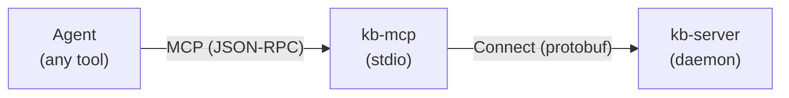

# Use Connect-Go and Protocol Buffers for Internal Daemon Communication

## Context and Problem Statement

kb-server runs as a background daemon that indexes vaults and handles semantic search queries. Multiple clients need to communicate with it:

- **kb-mcp**: The MCP server that bridges AI agents to kb-server

We need a protocol for the `kb-mcp/CLI ↔ kb-server` communication that:

1. Works over Unix sockets (security: nothing exposed to network initially)
2. SHOULD handle schema evolution gracefully (client and server may upgrade independently)
3. Supports bidirectional communication for future features
4. Remains viable when we move to networked deployment (containers, VMs)

**Scope**: This decision covers internal daemon communication only. The `Agent ↔ kb-mcp` link uses MCP (JSON-RPC over stdio), which is dictated by the MCP specification.

## Decision Drivers

- **Unix socket support** — Initial deployment is local-only; Unix sockets provide IPC without network exposure
- **Schema evolution** — Client and server binaries may be upgraded independently; the protocol SHOULD tolerate added/removed fields without breaking
- **Bidirectional communication** — Future features like progress streaming during indexing, vault change notifications, and MCP elicitation support require server-initiated messages
- **Debuggability** — Ability to inspect traffic during development without specialized tooling
- **Future network deployment** — Sandboxed execution in containers or VMs is on the roadmap; the protocol should work over TCP without architectural changes

## Considered Options

1. **encoding/gob with custom framing**
2. **net/rpc**
3. **gRPC (grpc-go)**
4. **Connect-Go with Protocol Buffers**

## Decision Outcome

Chosen option: **Connect-Go with Protocol Buffers**, because it provides schema evolution guarantees, bidirectional streaming, and superior debuggability while maintaining full gRPC wire compatibility if needed later.

### Consequences

- **Good**: Schema evolution is handled by Protocol Buffers' field numbering and wire format
- **Good**: Bidirectional streaming is supported for future event notifications and MCP elicitation
- **Good**: The Connect protocol allows debugging with curl and standard HTTP tooling (JSON over HTTP/1.1)
- **Good**: Unix sockets work via standard `net/http` patterns ([confirmed in connect-go#323](https://github.com/connectrpc/connect-go/issues/323))
- **Good**: Same server simultaneously speaks Connect, gRPC, and gRPC-Web protocols
- **Good**: Lighter dependency footprint than grpc-go (built on net/http)
- **Neutral**: Requires learning Protocol Buffer schema design, though AI tooling largely mitigates this
- **Bad**: Smaller ecosystem than pure gRPC, though Buf (the maintainers) are well-established

## Pros and Cons of the Options

### encoding/gob with custom framing

Go's native binary serialization format.

- **Good**: Zero external dependencies
- **Good**: Native Go types without schema files
- **Bad**: Requires implementing message framing manually (length-prefix or delimiters)
- **Bad**: No schema evolution guarantees — adding/removing fields can break compatibility
- **Bad**: Go-only; precludes future polyglot clients
- **Bad**: No built-in support for bidirectional streaming

### net/rpc

Go's standard library RPC package.

- **Good**: Simple, well-understood API
- **Good**: Works over Unix sockets
- **Bad**: Request-response only; no support for server-initiated messages or streaming
- **Bad**: Uses gob by default, inheriting its schema evolution limitations
- **Bad**: Limited community momentum; most new projects choose gRPC or alternatives

### gRPC (grpc-go)

Google's RPC framework with Protocol Buffers.

- **Good**: Industry standard with extensive tooling and documentation
- **Good**: Protocol Buffers provide strong schema evolution guarantees
- **Good**: Full bidirectional streaming support
- **Good**: Works over Unix sockets
- **Bad**: Binary-only protocol; debugging requires grpcurl or similar tooling
- **Bad**: Heavier dependency (grpc-go pulls in significant transitive dependencies)
- **Bad**: HTTP/2 required for most features

### Connect-Go with Protocol Buffers

Buf's HTTP-based RPC framework, wire-compatible with gRPC.

- **Good**: Same Protocol Buffer schema evolution benefits as gRPC
- **Good**: Bidirectional streaming support
- **Good**: Connect protocol allows JSON over HTTP/1.1 — debuggable with curl
- **Good**: Same server speaks Connect, gRPC, and gRPC-Web simultaneously
- **Good**: Built on net/http; lighter than grpc-go
- **Good**: Unix sockets work via standard Go patterns
- **Neutral**: Smaller community than gRPC, but growing and well-maintained
- **Bad**: Additional protocol to understand (though it's simpler than gRPC)

## More Information

- [Connect-Go documentation](https://connectrpc.com/docs/go/getting-started)
- [Unix socket support discussion](https://github.com/connectrpc/connect-go/issues/323)
- [MCP Elicitation specification](https://modelcontextprotocol.io/specification/2025-11-25/client/elicitation) — illustrates bidirectional communication patterns we may need to support
