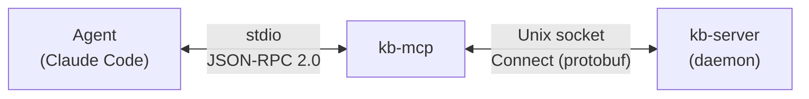

# Stub Implementation

## Overview

Build stub versions of both kb-mcp and kb-server, wired together end-to-end. This establishes the full communication pipeline with placeholder responses before implementing real functionality.

## Architecture



## Components

| Component | Transport | Purpose |
|-----------|-----------|---------|
| kb-mcp | stdio (MCP) | Exposes tools to AI agents |
| kb-server | Connect over Unix socket | Handles queries, returns stub responses |

## Tools

| Tool | Purpose |
|------|---------|
| `list_knowledge_bases` | Discover available knowledge bases |
| `ask_knowledge_base` | Query knowledge bases with natural language |

## Dependencies

| Package | Purpose |
|---------|---------|
| `github.com/modelcontextprotocol/go-sdk/mcp` | Official MCP SDK |
| `connectrpc.com/connect` | Connect RPC framework |
| `google.golang.org/protobuf` | Protocol Buffers runtime |

### Build Tools

| Tool | Purpose | Install |
|------|---------|---------|
| `buf` | Protobuf compilation and linting | `mise use buf` |
| `protoc-gen-go` | Go protobuf code generation | `mise use protoc-gen-go` |
| `protoc-gen-connect-go` | Connect client/server code generation | `mise use protoc-gen-connect-go` |

---

## Part 1: Protocol Buffers

### Proto Definition

```protobuf
// proto/kb/v1/kb.proto
syntax = "proto3";

package kb.v1;

option go_package = "github.com/ivy/kb/gen/kb/v1;kbv1";

// KnowledgeBaseService provides access to knowledge bases.
service KnowledgeBaseService {
  // List returns all available knowledge bases.
  rpc List(ListRequest) returns (ListResponse);

  // Query searches knowledge bases with a natural language question.
  rpc Query(QueryRequest) returns (QueryResponse);
}

// ListRequest is empty - no parameters needed.
message ListRequest {}

// ListResponse contains available knowledge bases.
message ListResponse {
  repeated KnowledgeBase knowledge_bases = 1;
}

// KnowledgeBase describes an available knowledge base.
message KnowledgeBase {
  string name = 1;
  string description = 2;
}

// QueryRequest contains the search parameters.
message QueryRequest {
  string question = 1;
  Effort effort = 2;
  repeated string knowledge_bases = 3; // empty = search all
}

// Effort controls search depth.
// EFFORT_UNSPECIFIED is required by buf lint (ENUM_ZERO_VALUE_SUFFIX) and
// protobuf convention — the wire default for an unset enum field is 0.
// Application code treats UNSPECIFIED the same as EFFORT_MEDIUM (balanced).
enum Effort {
  EFFORT_UNSPECIFIED = 0; // Treated as EFFORT_MEDIUM by the server
  EFFORT_LOW = 1;         // Quick lookup
  EFFORT_MEDIUM = 2;      // Balanced (default)
  EFFORT_HIGH = 3;        // Thorough research
}

// QueryResponse contains the answer and citations.
message QueryResponse {
  string answer = 1;
  repeated string citations = 2;
}
```

### Buf Configuration

```yaml
# buf.yaml
version: v2
modules:
  - path: proto
lint:
  use:
    - STANDARD
breaking:
  use:
    - FILE
```

```yaml
# buf.gen.yaml
version: v2
plugins:
  - local: protoc-gen-go
    out: gen
    opt: paths=source_relative
  - local: protoc-gen-connect-go
    out: gen
    opt:
      - paths=source_relative
      - simple
managed:
  enabled: true
  override:
    - file_option: go_package_prefix
      value: github.com/ivy/kb/gen
```

> **Note:** The `simple` option generates handler interfaces using
> `func(context.Context, *Req) (*Res, error)` instead of the default
> `connect.Request`/`connect.Response` wrappers. This keeps handler
> signatures clean for unary RPCs.

### Code Generation

Generated code is committed to `gen/` so that `go build` works without
requiring the buf toolchain. A `go:generate` directive at the module root
documents how to regenerate:

```go
// generate.go

//go:generate buf generate
package kb
```

Regenerate after editing `.proto` files:

```bash
go generate ./...
```

This creates:
- `gen/kb/v1/kb.pb.go` — Message types
- `gen/kb/v1/kbv1connect/kb.connect.go` — Connect client/server interfaces

> **CI tip:** Run `go generate ./... && git diff --exit-code` to catch
> stale generated code.

---

## Part 2: kb-server (Stub)

### File Structure

```
cmd/kb-server/
└── main.go

internal/server/
├── doc.go            # Package documentation (exists)
└── server.go         # Connect server implementation
```

### Server Implementation

```go
// internal/server/server.go
package server

import (
    "context"
    "fmt"
    "log"
    "net"
    "net/http"
    "os"
    "time"

    kbv1 "github.com/ivy/kb/gen/kb/v1"
    "github.com/ivy/kb/gen/kb/v1/kbv1connect"
)

// shutdownTimeout is the maximum time to wait for in-flight requests
// to complete during graceful shutdown.
const shutdownTimeout = 5 * time.Second

type Server struct {
    socketPath string
    httpServer *http.Server
}

func New(socketPath string) *Server {
    return &Server{socketPath: socketPath}
}

func (s *Server) Run(ctx context.Context) error {
    ln, err := listenSocket(s.socketPath)
    if err != nil {
        return err
    }

    mux := http.NewServeMux()
    path, handler := kbv1connect.NewKnowledgeBaseServiceHandler(s)
    mux.Handle(path, handler)

    s.httpServer = &http.Server{Handler: mux}

    log.Printf("listening on %s", s.socketPath)

    // Shut down gracefully when the context is cancelled.
    go func() {
        <-ctx.Done()
        log.Printf("shutting down...")
        shutdownCtx, cancel := context.WithTimeout(context.Background(), shutdownTimeout)
        defer cancel()
        s.httpServer.Shutdown(shutdownCtx)
    }()

    err = s.httpServer.Serve(ln)
    if err == http.ErrServerClosed {
        return nil
    }
    return err
}

// listenSocket creates a Unix domain socket at the given path, removing
// any stale socket file first. It binds atomically — if two processes
// race, exactly one will succeed and the other will get EADDRINUSE.
func listenSocket(path string) (net.Listener, error) {
    // Try to bind first. If it succeeds, there was no stale socket.
    ln, err := net.Listen("unix", path)
    if err == nil {
        return ln, nil
    }

    // If the path exists but no one is listening, it's stale — remove
    // and retry. If someone is listening, the retry will fail with
    // EADDRINUSE, which is the correct behavior.
    os.Remove(path)
    return net.Listen("unix", path)
}

// List returns available knowledge bases.
func (s *Server) List(
    ctx context.Context,
    req *kbv1.ListRequest,
) (*kbv1.ListResponse, error) {
    log.Printf("list_knowledge_bases: called")

    // Stub response
    return &kbv1.ListResponse{
        KnowledgeBases: []*kbv1.KnowledgeBase{
            {Name: "personal", Description: "Personal notes and documents"},
            {Name: "work", Description: "Work-related documentation"},
        },
    }, nil
}

// Query searches knowledge bases.
func (s *Server) Query(
    ctx context.Context,
    req *kbv1.QueryRequest,
) (*kbv1.QueryResponse, error) {
    effort := req.Effort
    if effort == kbv1.Effort_EFFORT_UNSPECIFIED {
        effort = kbv1.Effort_EFFORT_MEDIUM
    }

    log.Printf("ask_knowledge_base: question=%q effort=%s knowledge_bases=%v",
        req.Question, effort, req.KnowledgeBases)

    // Stub response
    answer := fmt.Sprintf("[STUB] Would search for: %s (effort=%s)", req.Question, effort)
    return &kbv1.QueryResponse{
        Answer:    answer,
        Citations: []string{},
    }, nil
}

// Ensure Server implements the handler interface.
var _ kbv1connect.KnowledgeBaseServiceHandler = (*Server)(nil)
```

### Entry Point

```go
// cmd/kb-server/main.go
package main

import (
    "context"
    "log"
    "os"
    "os/signal"
    "syscall"

    "github.com/ivy/kb/internal/server"
)

func main() {
    log.SetFlags(log.Ltime | log.Lshortfile)

    ctx, stop := signal.NotifyContext(context.Background(), syscall.SIGINT, syscall.SIGTERM)
    defer stop()

    srv := server.New(socketPath())
    if err := srv.Run(ctx); err != nil {
        log.Fatalf("server error: %v", err)
    }
}

func socketPath() string {
    if dir := os.Getenv("XDG_RUNTIME_DIR"); dir != "" {
        return dir + "/kb.sock"
    }
    return "/tmp/kb.sock"
}
```

---

## Part 3: kb-mcp (Stub)

### File Structure

```
cmd/kb-mcp/
└── main.go

internal/mcp/
├── doc.go            # Package documentation (exists)
├── server.go         # MCP server setup and tool registration
└── tools.go          # Tool input types
```

### Tool Input Types

```go
// internal/mcp/tools.go
package mcp

// ListKnowledgeBasesInput is the input for list_knowledge_bases.
type ListKnowledgeBasesInput struct{}

// AskKnowledgeBaseInput is the input for ask_knowledge_base.
type AskKnowledgeBaseInput struct {
    Question       string   `json:"question" jsonschema:"required,description=Your question"`
    Effort         string   `json:"effort,omitempty" jsonschema:"enum=low,enum=medium,enum=high,description=Search depth: low (quick lookup) / medium (balanced) / high (thorough)"`
    KnowledgeBases []string `json:"knowledge_bases,omitempty" jsonschema:"description=Limit search to specific knowledge bases by name. Omit to search all."`
}
```

### MCP Server

```go
// internal/mcp/server.go
package mcp

import (
    "context"
    "fmt"
    "log"
    "net"
    "net/http"
    "strings"

    kbv1 "github.com/ivy/kb/gen/kb/v1"
    "github.com/ivy/kb/gen/kb/v1/kbv1connect"
    "github.com/modelcontextprotocol/go-sdk/mcp"
)

type Server struct {
    mcpServer  *mcp.Server
    socketPath string
    httpClient *http.Client
}

func NewServer(socketPath string) *Server {
    s := &Server{
        socketPath: socketPath,
        httpClient: &http.Client{
            Transport: &http.Transport{
                DialContext: func(ctx context.Context, _, _ string) (net.Conn, error) {
                    return net.Dial("unix", socketPath)
                },
            },
        },
    }

    s.mcpServer = mcp.NewServer(
        &mcp.Implementation{
            Name:    "kb",
            Version: "0.1.0",
        },
        nil,
    )

    mcp.AddTool(s.mcpServer, &mcp.Tool{
        Name:        "list_knowledge_bases",
        Description: "List available knowledge bases.",
    }, s.handleList)

    mcp.AddTool(s.mcpServer, &mcp.Tool{
        Name:        "ask_knowledge_base",
        Description: "Search knowledge bases using natural language. Returns relevant context with source citations.",
    }, s.handleAsk)

    return s
}

func (s *Server) Run(ctx context.Context) error {
    return s.mcpServer.Run(ctx, &mcp.StdioTransport{})
}

func (s *Server) client() kbv1connect.KnowledgeBaseServiceClient {
    // URL host is ignored when using Unix socket transport
    return kbv1connect.NewKnowledgeBaseServiceClient(s.httpClient, "http://localhost")
}

func (s *Server) handleList(
    ctx context.Context,
    req *mcp.CallToolRequest,
    input ListKnowledgeBasesInput,
) (*mcp.CallToolResult, any, error) {
    log.Printf("list_knowledge_bases: called")

    resp, err := s.client().List(ctx, &kbv1.ListRequest{})
    if err != nil {
        return errorResult("failed to contact kb-server: " + err.Error()), nil, nil
    }

    // Format response
    var sb strings.Builder
    sb.WriteString("Available knowledge bases:\n")
    for _, kb := range resp.KnowledgeBases {
        fmt.Fprintf(&sb, "- %s: %s\n", kb.Name, kb.Description)
    }

    return &mcp.CallToolResult{
        Content: []mcp.Content{&mcp.TextContent{Text: sb.String()}},
    }, nil, nil
}

func (s *Server) handleAsk(
    ctx context.Context,
    req *mcp.CallToolRequest,
    input AskKnowledgeBaseInput,
) (*mcp.CallToolResult, any, error) {
    effort := parseEffort(input.Effort)

    log.Printf("ask_knowledge_base: question=%q effort=%s knowledge_bases=%v",
        input.Question, effort, input.KnowledgeBases)

    resp, err := s.client().Query(ctx, &kbv1.QueryRequest{
        Question:       input.Question,
        Effort:         effort,
        KnowledgeBases: input.KnowledgeBases,
    })
    if err != nil {
        return errorResult("query failed: " + err.Error()), nil, nil
    }

    return &mcp.CallToolResult{
        Content: []mcp.Content{&mcp.TextContent{Text: resp.Answer}},
    }, nil, nil
}

func parseEffort(s string) kbv1.Effort {
    switch s {
    case "low":
        return kbv1.Effort_EFFORT_LOW
    case "high":
        return kbv1.Effort_EFFORT_HIGH
    default:
        return kbv1.Effort_EFFORT_MEDIUM
    }
}

func errorResult(msg string) *mcp.CallToolResult {
    return &mcp.CallToolResult{
        Content: []mcp.Content{&mcp.TextContent{Text: msg}},
        IsError: true,
    }
}
```

### Entry Point

```go
// cmd/kb-mcp/main.go
package main

import (
    "context"
    "log"
    "os"
    "os/signal"

    kbmcp "github.com/ivy/kb/internal/mcp"
)

func main() {
    // MCP uses stdout for JSON-RPC transport; all logging must go to stderr.
    log.SetOutput(os.Stderr)
    log.SetFlags(log.Ltime | log.Lshortfile)

    ctx, stop := signal.NotifyContext(context.Background(), os.Interrupt)
    defer stop()

    server := kbmcp.NewServer(socketPath())

    if err := server.Run(ctx); err != nil {
        log.Fatalf("server error: %v", err)
    }
}

func socketPath() string {
    if dir := os.Getenv("XDG_RUNTIME_DIR"); dir != "" {
        return dir + "/kb.sock"
    }
    return "/tmp/kb.sock"
}
```

---

## Part 4: File Structure Summary

```
kb/
├── buf.gen.yaml
├── buf.yaml
├── generate.go           # go:generate directive for buf generate
├── cmd/
│   ├── kb-mcp/
│   │   └── main.go
│   └── kb-server/
│       └── main.go
├── gen/                  # Committed — go build works without buf toolchain
│   └── kb/
│       └── v1/
│           ├── kb.pb.go
│           └── kbv1connect/
│               └── kb.connect.go
├── internal/
│   ├── mcp/
│   │   ├── doc.go
│   │   ├── server.go
│   │   └── tools.go
│   └── server/
│       ├── doc.go
│       └── server.go
├── proto/
│   └── kb/
│       └── v1/
│           └── kb.proto
├── go.mod
└── go.sum
```

---

## Testing

### Unit Tests

```go
// internal/server/server_test.go
func TestList_ReturnsKnowledgeBases(t *testing.T) {
    s := &Server{}
    resp, err := s.List(context.Background(), &kbv1.ListRequest{})
    require.NoError(t, err)
    require.Len(t, resp.KnowledgeBases, 2)
}

func TestQuery_DefaultEffort(t *testing.T) {
    s := &Server{}
    resp, err := s.Query(context.Background(), &kbv1.QueryRequest{
        Question: "test",
        // Effort unspecified — should default to MEDIUM
    })
    require.NoError(t, err)
    require.Contains(t, resp.Answer, "EFFORT_MEDIUM")
}
```

### Manual Integration Test

**Terminal 1: Start kb-server**
```bash
$ go run ./cmd/kb-server
15:04:05 server.go:48: listening on /tmp/kb.sock
```

**Terminal 2: Test with curl (Connect protocol)**
```bash
# List knowledge bases
$ curl --unix-socket /tmp/kb.sock \
    -H "Content-Type: application/json" \
    -d '{}' \
    http://localhost/kb.v1.KnowledgeBaseService/List
{
  "knowledgeBases": [
    {"name": "personal", "description": "Personal notes and documents"},
    {"name": "work", "description": "Work-related documentation"}
  ]
}

# Query
$ curl --unix-socket /tmp/kb.sock \
    -H "Content-Type: application/json" \
    -d '{"question": "Who handles security?"}' \
    http://localhost/kb.v1.KnowledgeBaseService/Query
{
  "answer": "[STUB] Would search for: Who handles security? (effort=EFFORT_MEDIUM)"
}
```

**Terminal 2: Test with buf curl (gRPC protocol)**

> **Note:** Connect-Go handlers support the Connect, gRPC, and gRPC-Web
> protocols simultaneously — no additional configuration needed.

```bash
# List knowledge bases
$ buf curl --unix-socket /tmp/kb.sock \
    --schema proto \
    --protocol grpc \
    -d '{}' \
    http://localhost/kb.v1.KnowledgeBaseService/List

# Query
$ buf curl --unix-socket /tmp/kb.sock \
    --schema proto \
    --protocol grpc \
    -d '{"question": "Who handles security?"}' \
    http://localhost/kb.v1.KnowledgeBaseService/Query
```

**Terminal 2: Test via kb-mcp**
```bash
# Build and configure
$ go build -o kb-mcp ./cmd/kb-mcp

# Add to Claude Code MCP config (~/.claude/claude_desktop_config.json):
{
  "mcpServers": {
    "kb": {
      "command": "/absolute/path/to/kb-mcp"
    }
  }
}
```

**Claude Code: Verify tools and test**
```
> /mcp
[Should show kb server with list_knowledge_bases and ask_knowledge_base tools]

> What knowledge bases are available?
[Calls list_knowledge_bases]
Available knowledge bases:
- personal: Personal notes and documents
- work: Work-related documentation

> Who handles security?
[Calls ask_knowledge_base]
[STUB] Would search for: Who handles security? (effort=EFFORT_MEDIUM)
```

**Expected kb-server logs:**
```
15:04:06 server.go:69: list_knowledge_bases: called
15:04:07 server.go:82: ask_knowledge_base: question="Who handles security?" effort=EFFORT_MEDIUM knowledge_bases=[]
```

---

## Acceptance Criteria

- [ ] `buf lint` passes
- [ ] `buf generate` succeeds
- [ ] `go generate ./...` regenerates without diff
- [ ] `go build ./...` succeeds
- [ ] kb-server starts and listens on socket
- [ ] kb-server responds to curl requests (Connect protocol)
- [ ] kb-server shuts down gracefully on SIGINT/SIGTERM
- [ ] kb-mcp registers both tools with correct schemas
- [ ] kb-mcp connects to kb-server via Connect
- [ ] `list_knowledge_bases` returns stub list through full pipeline
- [ ] `ask_knowledge_base` returns stub response through full pipeline
- [ ] Connection errors surface as tool errors (not crashes)
- [ ] Works end-to-end in Claude Code

---

## Error Handling

| Scenario | Behavior |
|----------|----------|
| kb-server not running | kb-mcp returns error result: "failed to contact kb-server" |
| Connect timeout | kb-mcp returns error result with timeout message |
| Missing `question` | MCP SDK validates schema, returns JSON-RPC error |
| Stale socket file | kb-server removes it and rebinds; second instance gets EADDRINUSE |

---

## Out of Scope (This Phase)

- Real query processing (semantic search, embeddings)
- Database operations
- Configuration files
- TLS (Unix socket is local-only)

---

## References

- [Official MCP Go SDK](https://github.com/modelcontextprotocol/go-sdk)
- [Connect-Go](https://connectrpc.com/docs/go/getting-started)
- [Protocol Buffers](https://protobuf.dev/)
- [Buf](https://buf.build/docs/)
- [ADR: Connect-Go for Internal Communication](../../adrs/001-connect-go-protocol-buffers.md)
