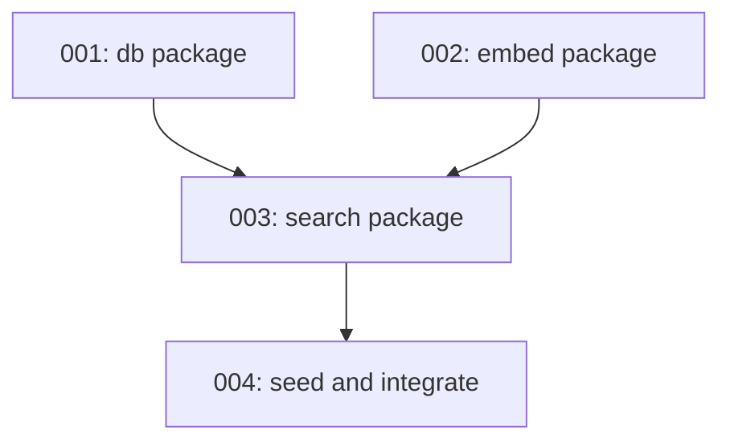

# Phase 2: Storage

**Goal:** Real database and embedding infrastructure with end-to-end data retrieval.

## Overview

Implement the storage layer for semantic search:
- SQLite + sqlite-vec for vector storage
- OpenAI embeddings via `text-embedding-3-small`
- Vector similarity search
- Seed data for validation
- Server integration for real query responses

## End State

By the end of Phase 2, you can:
```bash
# Start server
kb-server

# Query via kb-mcp from Claude Code
> Who handles security at Acme Corp?

# Gets back actual search results
"Found 2 relevant notes:
- people/sean-johnson.md (similarity: 0.89)
- meetings/2026-01-architecture-review.md (similarity: 0.76)"
```

Not synthesized by Claude yet (Phase 4), but **real data retrieval working**.

## Package Breakdown

| Package | Purpose | Time Estimate |
|---------|---------|---------------|
| `internal/db` | SQLite + sqlite-vec, schema, CRUD | ~1 hour |
| `internal/embed` | OpenAI embeddings client | ~45 min |
| `internal/search` | Vector similarity queries | ~45 min |
| Integration | Seed data, wire to server | ~1 hour |

**Total:** ~3.5 hours

## Implementation Order



1. **db package** - Foundation for storage
2. **embed package** - Can develop in parallel with db
3. **search package** - Combines db + embed
4. **seed and integrate** - Wire into server, validate end-to-end

## Success Criteria

- [ ] Database creates successfully at `${XDG_DATA_HOME}/kb/<vault-id>.sqlite`
- [ ] Can insert/query vaults and notes
- [ ] Can embed text via OpenAI API
- [ ] Vector search returns ranked results
- [ ] Server returns real search results (not stubs)
- [ ] Seed vault with ~5 dummy notes validates the pipeline

## Notes

- **Walking skeleton principle**: Keep it working end-to-end at every step
- **Claude synthesis** deferred to Phase 4 - this phase proves the data pipeline
- **Vector store decision** (sqlite-vec vs alternatives) deferred - will evaluate libsql and others before committing
